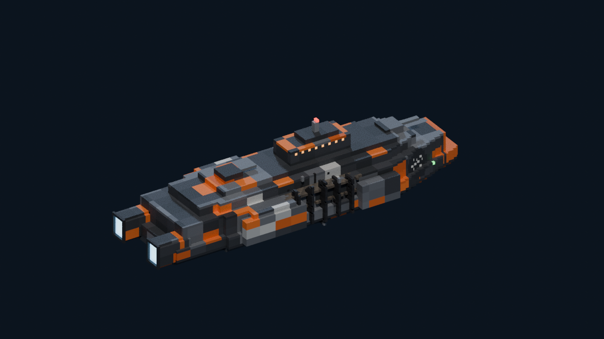
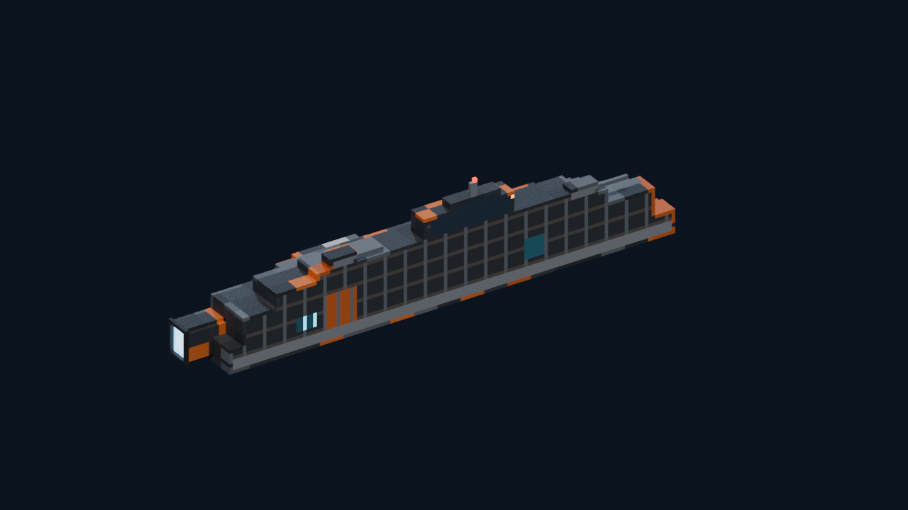
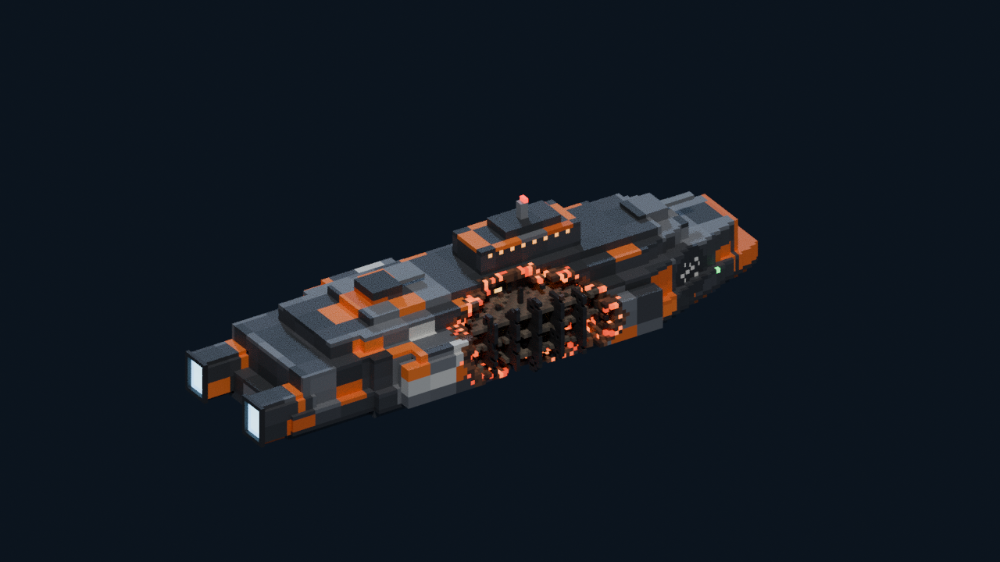
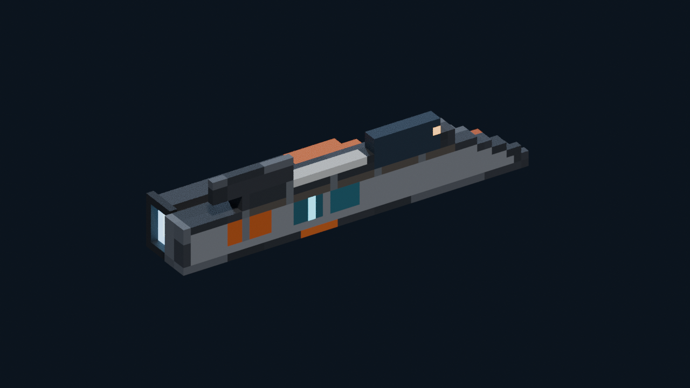

# Damage-ready MVP hull assets

Five intact master hulls now accompany the existing scene models, with named functional regions
and an initial F-317 damage fixture. The package prepares the assets for damage and repair;
live combat, module failure and repair remain their MVP implementation tasks.

| Vessel | Editable master | Grid, VOX X × Y × Z | Solid cells | Regions |
|---|---|---|---:|---:|
| Frigate | `Assets/Models/FrigateIntact.vox` | 48 × 150 × 40 | 81,369 | 10 |
| Lancer escort | `Assets/Models/EscortLancerIntact.vox` | 28 × 52 × 18 | 4,230 | 8 |
| Talon escort | `Assets/Models/EscortTalonIntact.vox` | 44 × 42 × 16 | 3,158 | 9 |
| Tug | `Assets/Models/TugIntact.vox` | 26 × 38 × 22 | 6,870 | 8 |
| Raider | `Assets/Models/RaiderIntact.vox` | 48 × 54 × 20 | 7,496 | 8 |

Each master has one fully occupied core region, and every solid voxel is connected to it by
face neighbors. All carry the existing byte-identical canonical palette. Grid sizes, default
pivots and VOX-to-world axes match their corresponding scene model. Existing model files,
`Scene.txt` and flight archetypes are unchanged.

The frigate's starboard armor is restored from the original undamaged mirrored hull geometry.
The new masters have readable enclosed framing, deck layers and component colors: teal/cyan core
hardware, orange reactor assemblies, blue engine conduits and steel weapon systems. Surface
paint and exterior silhouettes of the already-intact smaller ships are preserved. These are
colored structural interiors, not a new walkable-room system or a change to flight mass.





The images are offline renders of the actual VOX geometry. The cutaway is made in memory for
inspection and is never saved over the master. No burned paint is baked into an intact master.

## Initial damage and appearance

`Assets/Hulls/FrigateF317.txt` removes **5,063 master cells** to reproduce the existing frigate's
occupancy exactly. It separately references the hashed legacy preview for its palette appearance:
scorch, embers, exposed frames and the old interior paint. This avoids treating burned colors as
the original material. Expanding that reference currently yields 57,366 cosmetic color differences.

Applying the presence mask and appearance produces the byte-identical original `Frigate.vox`.
Restoring all master cells and clearing the appearance yields the byte-identical `FrigateIntact.vox`.
The existing preview's disconnected tiny breach pieces remain in that fixture; the clean master
has restored supporting ties. Runtime breakup remains the separation system's job.



The source data is in the familiar record grammar. Region boxes use minimum-inclusive,
maximum-exclusive VOX coordinates. A run index is `x + sizeX * (y + sizeY * z)`.
The exact authoring schema and its runtime boundary are recorded in
[ADR-021](ADR/ADR-021-damage-ready-hull-authoring.md).

## Regions and integration

`Assets/Hulls/Hulls.txt` has 43 named annotations across the five ships: core, power, engines,
sensors, shields, weapons, the tug's clamps/cargo systems, frigate atmospherics and diagnostic
structural sections. Every region references a real hull, stays inside its grid and contains
actual source voxels. A core region is completely solid. Counts are taken over source voxels,
not the volume of potentially empty cells inside a region box.

These sidecars are **authoring data**, not a runtime content loader or implemented voxel-mask
protocol. The source hashes make stale masks and annotations detectable. ADR-012 and ADR-014
will define runtime masks, material behavior, failure thresholds and import into typed content.
No proposed thresholds or new ship balance values are introduced by this asset pass.

Future integration should load the intact master as the structural/material source, apply a
presence mask, and keep cosmetic appearance out of physics. Save or replicate damage through
the future authority path. A clean repaired state is the master plus full presence and no damage
appearance. Do not use the preview's colors as material strengths. The current scene continues
using its original model names/files until that runtime path exists.



## Editing and validation

Open the `*Intact.vox` files directly in MagicaVoxel. Keep the canonical palette, size, pivot
convention and connectivity to the core. After changing geometry or annotations, refresh
sidecars and validate. A master must contain every cell required by its starting preview.

```sh
# Python 3.10+ and NumPy; development tooling only.
python Tools/ValidateHullAssets.py --report /tmp/HullValidation.json
python Tools/TestHullAssets.py

# Preserve direct VOX edits; rehash masters and rederive the fixture.
python Tools/PrepareHulls.py --refresh

# Rebuild the initial art pass separately; never overwrite manual edits inadvertently.
python Tools/PrepareHulls.py --output /tmp/HullAssets

# Actual-geometry review views; these do not modify source files.
blender -b -t 3 --python Tools/PreviewHulls.py -- --hull Frigate --view intact --output /tmp/Frigate.png
blender -b -t 3 --python Tools/PreviewHulls.py -- --hull Frigate --view cutaway --output /tmp/Cutaway.png
blender -b -t 3 --python Tools/PreviewHulls.py -- --hull Frigate --view damaged --output /tmp/F317.png
```

Validation checks canonical palettes, source hashes, sizes, regions, one connected core per hull,
sorted non-overlapping in-bounds mask runs, exact preview occupancy and appearance, exact repair,
and a full-section severance that detaches the frigate's bow. Eleven contract tests also exercise
invalid fields, missing/multiple cores, stale sources, invalid regions and malformed masks.
CI runs the authoring checks. Normal Windows palette/file tests cover all new VOX assets.

The models and sidecars are copied in both Debug and Release builds. Native file-format checks
and offline rendering do not verify a live Windows damage renderer or runtime repair; neither
is implemented by this authoring-only change.
