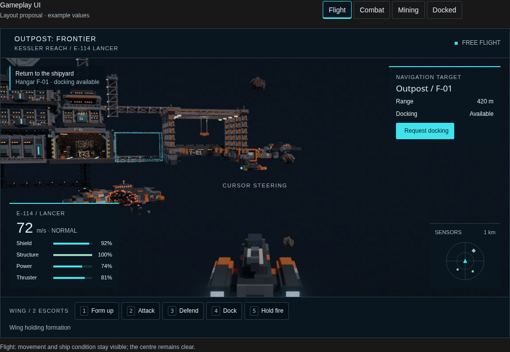
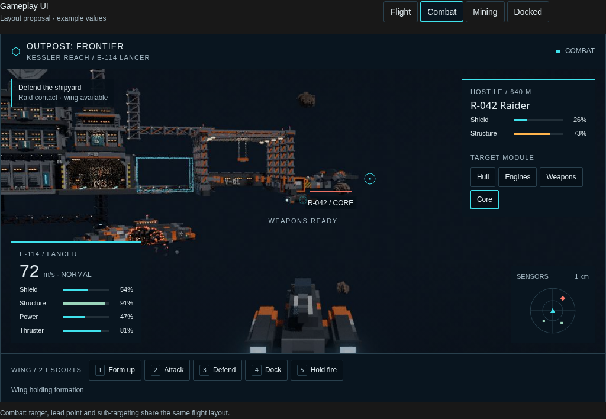
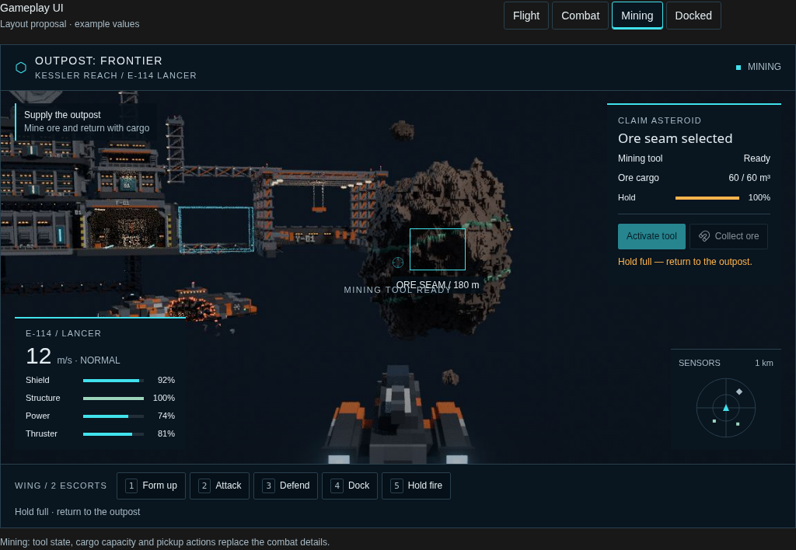
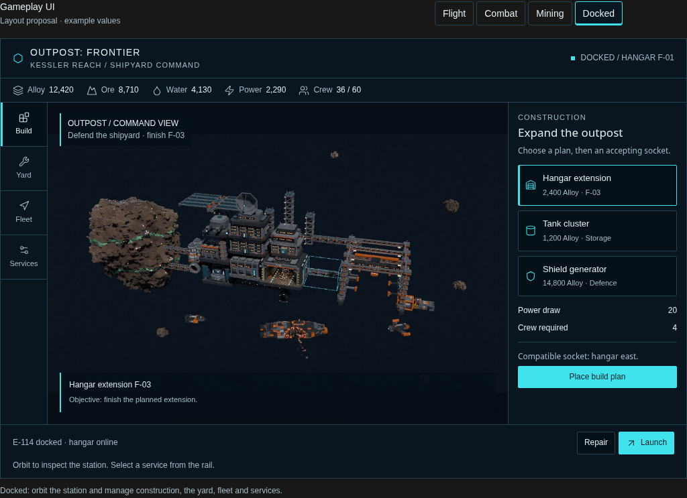

# Gameplay UI proposal

**Status:** proposal for review; no game implementation or approved gameplay rules change.
**Confirmed constraint:** shipped UI artwork uses DDS textures, as requested on 2026-11-22.

## Review files

The proposal and its interactive study are now versioned together. Download/open
[the standalone preview](GameplayUi/gameplay-ui-preview.html) in a browser to try Flight,
Combat, Mining and Docked contexts. Its [editable source](GameplayUi/gameplay-ui-source.html)
retains the original interaction study. The screenshots below are browser renders of that study,
using example data; they are not captures of an implemented replacement game HUD.

| Flight | Combat |
|---|---|
|  |  |

| Mining | Docked command |
|---|---|
|  |  |

The current game already has the flight work merged separately on `main`. This document proposes
the broader UI/DDS direction; merging the review files does not implement the proposed DDS loader,
management screens, combat or mining systems. [Preview checks](GameplayUi/PreviewChecks.json)
record the standalone study's interactions and layout results.

## Direction

Retain the sample's industrial command identity: deep blue panels, restrained cyan accents,
off-white readable text, amber warnings and red threats. Reduce ornamental framing around ordinary
information. Keep the station and ships prominent. Small labels use sentence case; headings and
short status identifiers may use capitals. Color always accompanies a name, icon, shape or status.

The game has **two views**. Flight, combat and mining are contexts of the flight view, sharing one
layout and the same instrument positions. Docked command is the tactical view. Docking and launching
are the transitions between the two, as GameDesign.md D10 requires. The four preview selectors are
review controls, not an in-game switch that bypasses docking.

The interaction study uses example values and local simulated actions. Costs, power draws, cargo
capacities, ranges, keyboard bindings and damage values shown there are illustrative. They do not
set balance, implement a server or replace the blueprint's rules.

## Screen proposals

| Context | Persistent information | Context actions | Space kept clear |
|---|---|---|---|
| Flight | Speed/regime, shield, structure, power and thruster pools; navigation target; sensors; wing command strip | Dock request, wing orders | Aiming, ship motion and the forward view |
| Combat | Same flight instruments, hostile target identity/range, shield/structure, lead point and chosen module | Hull/engines/weapons/core sub-targeting; attack, defend, hold fire | Reticle and the target's silhouette |
| Mining | Same flight instruments, selected ore seam, tool state, cargo volume and tractor availability | Activate tool, collect reachable loot, return to dock | The rock face and mining feedback |
| Docked command | Station view, resources and capacity, objectives, selected object and current order | BUILD, YARD, FLEET, SERVICES; launch | Most of the station remains visible between the rail and inspector |

### Flight

Anchor own-ship condition at lower left, a compact sensor display at lower right, target/navigation
details at upper right, and one objective line at upper left. A low wing strip exposes form up,
attack target, defend, dock and hold fire. Keycaps come from active bindings, not baked artwork.
Power, thruster and shield are distinct quantities. Speed always carries its unit and flight regime.
Cruise charging, active cruise, engine kill and depleted thruster states get explicit labels.

The normal view is calm. Critical shield, engine or power conditions add one short message beside
the instruments that explain it, with no full-screen flashing. A compact setting can collapse
secondary readouts, but depletion and critical warnings bring the relevant readout back.

### Combat

Preserve the position of own-ship instruments. Add hostile brackets, a separate lead marker,
range, target shield/structure and a module selector. The selected module must be named both in
the panel and at the target. A shield collapse has a visible rebuild state; structural damage
and unavailable equipment show their own reasons. Off-screen targets retain edge arrows.
Markers are projected from world objects and avoid reserved UI rectangles where possible.

### Mining

Swap combat details for the selected rock/seam, tool state, hold usage and tractor availability.
A pickup confirms the quantity collected and updates the hold. A full hold disables collection
and mining with a visible reason and a return-to-base cue. Range, power and incompatible-target
refusals use the same message style. The mockup demonstrates hold filling without running a simulation.

### Docked command

Use a narrow navigation rail and one context inspector rather than showing every management panel
simultaneously. Resources stay in the station header. Selection in the world, fleet list and inspector
must identify the same object.

- **BUILD:** choose a held plan, inspect cost and operating requirements, highlight accepting sockets,
  preview placement, confirm or cancel, then show authoritative construction progress. Resource
  spending follows construction rules; selecting a plan does not spend Alloy. An unavailable plan
  or insufficient resources has a visible explanation.
- **YARD:** owned hull plans, build queue and docked refit. Only compatible equipment is offered;
  crew/Alloy/yard availability explains refusals.
- **FLEET:** owned units, task, condition and concise orders. Multiple selection, go-to, defend,
  dock and itinerary assignment grow from the same directive model. In flight this remains the
  small wing command set rather than full fleet management.
- **SERVICES:** repair, launch and docked save. Launch checks engine and power availability;
  loss of a hangar explains why repair is unavailable.

## Interaction contract

Controls share idle, hover/focus, pressed, selected, disabled-with-reason, pending, confirmed and
refused states. Confirmation comes from authority state or replies; the production UI never treats
a click as proof that construction, repair, docking or a fleet order succeeded. Escape cancels a
placement or closes the top interaction before reaching the pause menu. Menu focus suppresses
flight input and releases held controls on a context change.

The mockup's Launch action shows a pending request; the review selectors expose the flight layout.
In the actual game the UI stays docked until the docking system confirms the launch transition.
Numeric ship health comes from masks when slice 3 is implemented; until then a preview is labeled
as example data. No stale values silently stand in for unknown or out-of-sensor-range objects.

## DDS texture proposal

DDS is the **container**; the DXGI format, color space, alpha convention and sampling policy are
declared per asset. Use the DX10 DDS header for explicit formats. These are proposed atlas sizes,
not files already produced or measurements of the current renderer.

| Proposed texture | Size | DXGI format | Content | GPU payload, one mip |
|---|---:|---|---|---:|
| `UiMasks.dds` | 1024 × 1024 | `R8_UNORM` | Monochrome commands, resources, targeting symbols, focus/selection masks | 1 MiB |
| `UiColor.dds` | 1024 × 1024 | `BC7_UNORM_SRGB` | Multicolor insignia, colored illustrations and richer state artwork | 1 MiB |
| `UiFrames.dds` | 512 × 512 | `BC7_UNORM_SRGB` | Panel finishes, subtle texture, corners and stretchable frame pieces | 0.25 MiB |

The proposed authored-atlas payload is **2.25 MiB**, excluding file headers, D3D allocation alignment,
descriptors and runtime fonts. Set an initial **4 MiB authored-art budget**, to be checked after export.
`R8G8B8A8_UNORM_SRGB` is an allowed uncompressed color option when a particular atlas does not
survive BC7 quality review. Texture names and sizes can change as the actual asset census is packed.

Thin reticles, rules and progress bars stay crisp through geometry or uncompressed masks.
DDS does not require compressing every element. Do not rasterize labels, numbers, key bindings,
progress values or entire screens into DDS. Keep ship/module thumbnails as live voxel previews.

All authored UI texture files are DDS. Keep the existing GDI-generated `R8_UNORM` font atlas for
arbitrary UI scales in the first implementation; it is a generated GPU texture, not a shipped image
file. If a persistent or prebaked font atlas is later adopted, store its coverage in R8 DDS with
separate metrics and the required glyph set. Text remains live in either case.

### Authoring and sampling

Keep editable vector/layered sources separately from runtime DDS output. Export deterministically
with an offline tool such as Microsoft's `texconv`; R14 permits development-only tools. This does
not approve linking DirectXTex or DirectXTK into the executable. Any new runtime library would
need its own explicit approval and ADR.

For the MVP, screen-space UI atlases have **one mip level**, matching the existing HUD's explicit
LOD-0 sampling. Supply adequate source resolution for supported UI scales and use linear-clamp
sampling. Place compressed rectangles on 4-texel boundaries and reserve/extrude an 8-texel gutter.
Mipped world-space artwork, if introduced later, uses separate assets and its own mip policy.

Use sRGB decoding for color art, linear values for masks/coverage, and linear-space blending into
the existing sRGB render target. Retain the current **straight-alpha** convention for the first
implementation: `SRC_ALPHA / INV_SRC_ALPHA`. Mark RGBA DDS alpha mode explicitly and validate it;
R8 is interpreted as coverage. Do not mix premultiplied art into that path. Author transparent
color borders with edge-color bleed rather than black RGB to avoid dark filtering fringes.

Use a named sprite manifest for atlas rectangles, native sizes, mask/color kind and nine-slice
margins. Runtime code refers to stable identifiers such as `Order.Attack` and `Status.NoPower`,
not atlas packing coordinates. Align its record syntax with the content-record ADR when settled.
The full manifest is validated when content loads.

## Renderer and game integration

The current `HudBatch` builds geometry plus text using one R8 coverage atlas. `HudPS.hlsl` samples
a scalar and tints it; it cannot display arbitrary RGBA DDS art yet. `Renderer::SetHudAtlas` uploads
R8 data and the current HUD uses straight-alpha blending. Therefore the proposal needs:

1. A bounded DDS reader for ordinary 2D DX10 files in the declared formats, with validated headers,
   sizes, payloads and alpha metadata. Cubemaps, arrays and volumes can wait until needed.
2. Static texture upload that handles block-compressed row layouts using D3D12 copyable footprints,
   validated format support and shader-resource descriptors. Existing Windows SDK facilities suffice.
3. Colored sprites, mask sprites and nine-slice panels in HUD batching, while retaining the current
   R8 text/solid path. Keep draw order and the current back/front thumbnail layering correct.
4. UI input focus, hit rectangles, selection, reasons and command feedback driven by snapshot and
   command state. Renderer utilities stay in `NeuronClient`; gameplay screens stay in `GameApp`.

An ADR records the agreed DDS subset, atlas metadata, color/alpha rules and batch changes before
implementation. Update `GameDesign.md` with accepted UI choices before coding a choice that affects
gameplay. Register every shipped texture and manifest in both configurations of the Outpost project
and its filters; do not load assets relative to the working directory.

## Scale, accessibility and validation

Target 1280 × 720, 1920 × 1080, 2560 × 1440 and 3840 × 2160, with a separate user UI-scale control.
Use a 1920 × 1080 reference layout, safe margins and pixel-snapped edges. Proposed production body
text is 16 px at the reference scale; secondary labels should remain at least 14 physical pixels
at supported window sizes. Handle 16:10 and ultrawide by anchoring rather than stretching panels.
The in-conversation preview reflows at narrower widths for review; this does not promise a mobile game.

Focus is visible, every command is keyboard accessible and remappable, disabled reasons are readable
without hover, health/status never depends on color alone, and UI motion respects reduced-motion
preferences. A shortage is explicit text near the affected action, not just a gray button.

Implementation acceptance checks cover:

- Valid and truncated DDS files; supported/rejected formats; compressed payload sizes and uploads;
  source images compared with rendered sprites over bright and dark backgrounds.
- Sprite references, atlas bounds and nine-slice margins; batching order and thumbnail composition.
- Flight input capture, cancellation, keyboard focus and remapped key labels.
- All screen/state layouts at supported resolutions; UI/world-marker overlap and off-screen targets.
- Pending/accepted/refused commands, target loss, full cargo, low power, shield collapse, missing
  hangar services, unavailable plans and insufficient Alloy.
- Hardware captures and the MVP's frame-time budget, including the expanded station and combat.

The proposal's browser interaction and layout checks validate only the review mockup. They do not
validate a Windows DDS loader, GPU compression quality or the in-game HUD; those need the implementation.

## Suggested implementation order

1. **UI foundation:** DDS loading, named atlases, sprites/nine-slice support, shared control states,
   input focus and scale. First skin the existing tactical HUD as a reference integration.
2. **Flight and docking:** flight instruments, navigation target, wing strip and dock/launch feedback,
   connected as the relevant MVP simulation slices become available.
3. **Combat and mining:** target/modules/lead/shield feedback, then tool/hold/tractor UI.
4. **Docked management:** BUILD placement/progress, YARD, FLEET and SERVICES, with authoritative data.

Start with the DDS foundation and one complete flight screen. Then implement the docked BUILD
flow to make F-03 the first end-to-end management interaction. Keep new visual assets to the
small reusable atlas set rather than a separate texture for every panel or screen.

## References

- `Design/GameDesign.md` §3.1 and D10: view availability and command scope.
- `Design/ImplementationPlan.md`: 1.9 flight HUD; 2.5 docked services; 3.10 combat; 4.7 build;
  5.8 mining/cargo; 6.4 fleet commands.
- `GameApp/TacticalHud.*`, `NeuronClient/HudBatch.*`, `NeuronClient/FontAtlas.*`,
  `NeuronClient/Renderer.cpp`, `NeuronClient/Shaders/Hud*.hlsl` and `Hud.hlsli`: current UI baseline.
