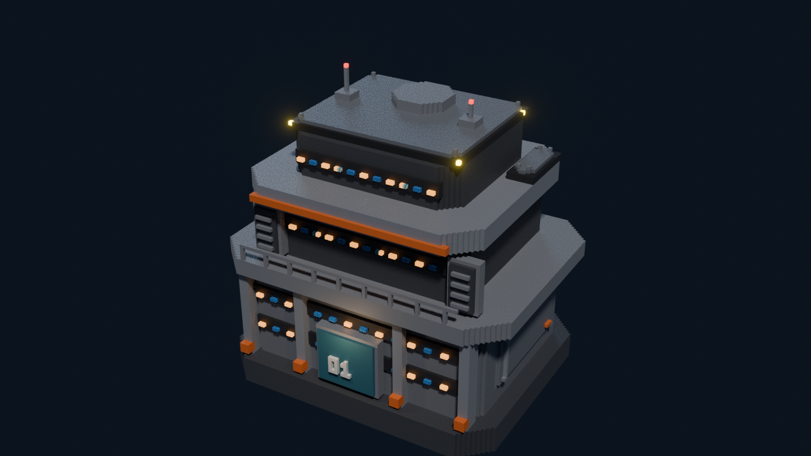

# Strobes and blue windows

The shared palette now includes two reusable colors. They are voxel color indices, not RGBA
chunk offsets; MagicaVoxel displays the emission/glass attributes stored with each file.

| Role | Voxel index | RGBA | Behavior |
|---|---:|---|---|
| `STROBE_YELLOW` | **224** | **255, 224, 48, 255** | Bright emissive yellow; two 90 ms flashes every 1.5 s in game |
| `WINDOW_BLUE` | **225** | **75, 162, 235, 80** | Blue glass; roughly 31% covered and 69% see-through |

All 32 files in `Assets/Models` carry the same updated palette and the two MagicaVoxel `MATL`
definitions. Twenty-five manufactured models have distributed strobes. Seventeen have blue cockpit
or observation panes with inspection recesses behind them. Warm lit windows remain for contrast.
Asteroids and loose debris retain their existing geometry and receive no new lamps.

Open any model in MagicaVoxel and reuse these palette slots. The yellow slot has the Emit material
and the blue slot has Glass. MagicaVoxel renders yellow emission steadily; the game animates the
double flash, including its halo. The game uses screen-door coverage for glass, so the background
shows through without sorting voxel instances. The precise rendering limits and properties are in
[ADR-022](ADR/ADR-022-signal-and-glazing-materials.md).

The intact hulls keep their occupied core regions and remain connected. The F-317 presence mask
and appearance reference have been refreshed against the edited sources and still reproduce the
starting preview exactly. No grid sizes, pivots, socket definitions or scene placements change.



This is an offline render of the edited source geometry, not a Windows gameplay capture.

## Checks and editing

```sh
python Tools/ValidateSignalMaterials.py --report /tmp/SignalValidation.json
python Tools/ValidateHullAssets.py
python Tools/TestHullAssets.py
python Tools/ValidateStation.py
```

`Tools/AuthorSignalMaterials.py` is the optional initial authoring pass; it preserves models already
carrying strobes. Committed VOX files are the editable sources. To reproduce that pass from a copy of
the prior assets, use `--source /path/to/baseline/Assets --assets /tmp/Signals`. It is not a build step.
After a manual hull edit, run `Tools/PrepareHulls.py --refresh` and validate again.

The C++ writer preserves authoring attributes when passed `document.materials`; keep that third
argument when round-tripping an imported document. Rendering always uses the game's canonical
palette and material table. No DDS textures are needed for these voxel palette materials.
