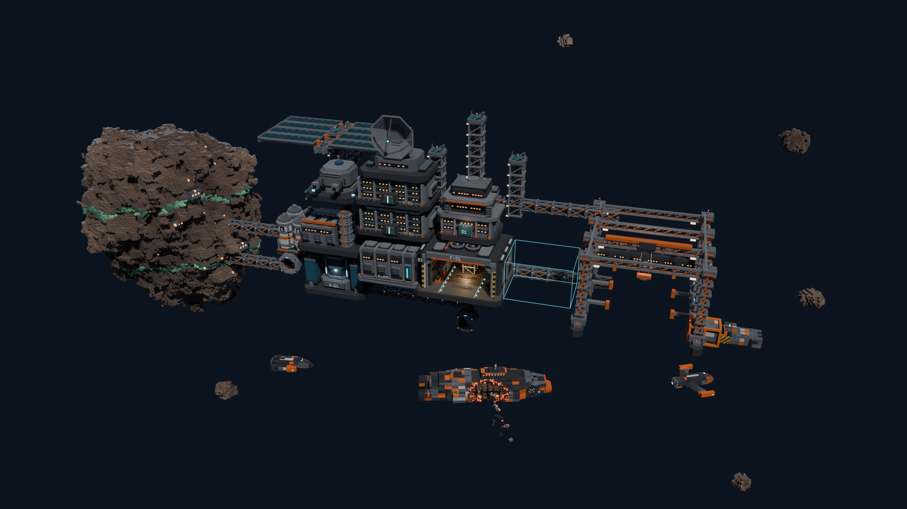
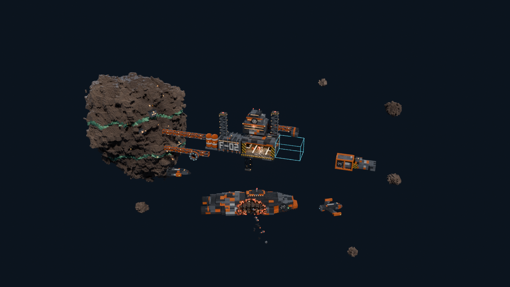
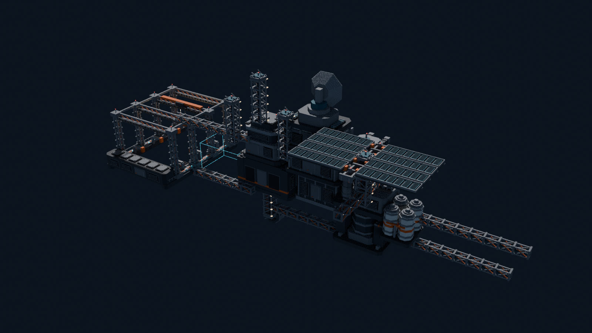
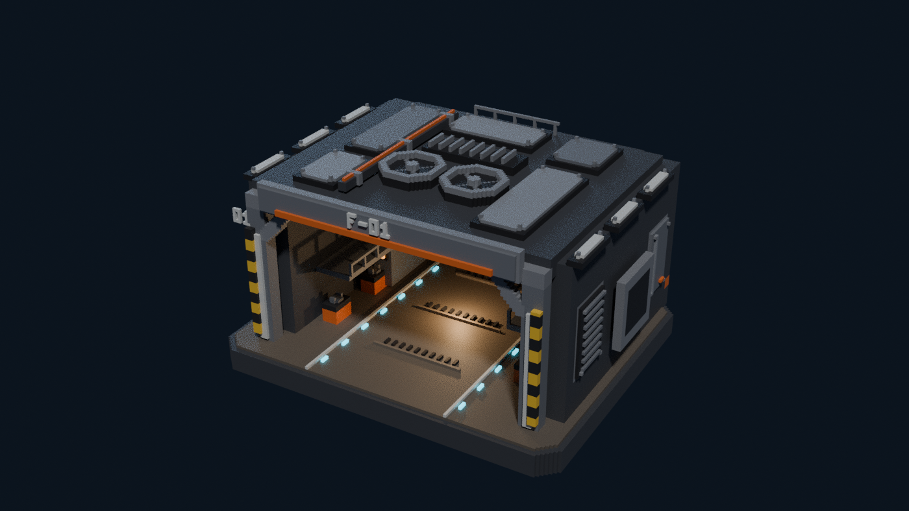

# Frontier shipyard — scale and detail pass

The station is now a connected industrial campus: an asteroid anchor, processing plant,
stacked crew blocks, a command crown, external heat rejection and a large open capital-ship drydock.
Thirteen existing station models were reauthored and `RadiatorArray.vox` was added.
The component VOX files and `Assets/Scene.txt` are the game-ready source assets.



These are **offline Blender geometry previews**, not Direct3D captures. The same camera is used
for the before/after scene comparison. Lighting is an approximation of the game's materials and
point lights; the HUD, stars, engine sprites and runtime blueprint lattice are not reproduced.
The blue box in the preview is only the planned extension's envelope; the game still draws
the section's actual coarse-occupancy wireframe.

## What the original assets needed

The original 26 VOX files already had consistent palette semantics, clear industrial orange/gray
color blocking, a convincing damaged frigate and a useful modular assembly system. The rock,
fleet, tug cargo and damage fragments provided good reference objects for judging station scale.

The station itself was underdeveloped relative to that fleet. Its visible assembly used only
12 solid modules, with a small hangar beside a frigate whose scene scale made it visually dominant.
Large labels and broad hazard stripes consumed much of the available facade resolution. Uniform
wall slabs had little intermediate detail between the overall block and individual voxels.
The command block and some lattice structures also appeared detached rather than supported.

Six authored station archetypes were absent from the scene: habitat, reactor, refinery, turret,
shield generator and yard. Their silhouettes provided a natural way to give the outpost distinct
operational districts. The existing fleet and asteroid geometry were retained as scale references.

## The art direction

- **Primary forms:** an asymmetric, stepped skyline, long structural roots into the asteroid,
  a broad thermal wing, a dish and mast above the command district, and a large open drydock.
  Clear empty space in the dock preserves its silhouette at tactical camera distances.
- **Secondary structure:** armored ribs, portal frames, pressure vessels, crane bridges,
  radiator leaves, repair arms, load-bearing walkways and recessed equipment cassettes.
- **Small scale cues:** narrow window rows, ladders, railings, bolts, segmented deck markings,
  machinery access panels and intermittent navigation lights. Signage becomes a small accent.
- **Material hierarchy:** charcoal recesses and machinery, gray armor, selective off-white trim,
  muted teal equipment, orange handling hardware, warm occupied spaces and cyan docking guidance.
  Large panels remain non-emissive; point-glow materials are reserved for small beacons.
- **All-around modeling:** equipment panels continue onto side, rear and selected underside
  surfaces. The hangar roof has unequal armor islands, two fans and an equipment grille rather
  than a uniform field of identical plates.

## Measured scale

Measurements use occupied voxels transformed by `Scene.txt`, exclude the construction ghost,
asteroid and ships, and include structural roots. World units are not relabeled as meters.

| Station measure | Before | After |
|---|---:|---:|
| Solid component instances | 12 | 27 |
| Occupied width, world X | 274 | 629.25 |
| Occupied height, world Y | 132 | 253.5 |
| Occupied depth, world Z | 68 | 214 |

That is **2.30 times the width, 1.92 times the height and 3.15 times the depth**.
Most component grids double on every axis and use `voxelsize=0.75`, making those individual
components 1.5 times larger in world space while allowing more subdivision. The drydock has a
custom 180 × 240 × 128 VOX grid: 135 wide, 96 high and 180 deep in world units.
The new radiator uses a 224 × 128 × 24 grid. Every individual runtime model stays within 256 cells
on every axis, with one model per file and the original canonical palette.

| Component | New geometry |
|---|---|
| HangarBay | Deep chamfered portal, interior frames, booths, service balconies, deck guides, rear blast door, roof fans |
| HangarSection | Ribbed enclosed service block, small identity marks, ventilation bays, utility door and roof equipment |
| CommandBlock | Three stepped operations levels, narrow recessed windows, catwalk, buttresses and antennae |
| TankCluster | Faceted pressure vessels, structural collars, valves, pipework and access rungs |
| DockingCollar | Layered octagonal throat, locking shoes, inner collar and guidance lights |
| TrussBeam / TrussTower | Open bracing, collars, protected conduits, ladders and small service lights |
| Habitat | Three window levels, external ribs, service airlock, roof equipment and end mounts |
| Reactor | Armored central vessel, cooling connections and separate graphite heat-exchanger leaves |
| Refinery | Distillation columns, manifolds, valves, access bridge and ventilation equipment |
| TurretPlatform | Faceted turret housing, articulated-looking base, reinforced barrels and sensor mast |
| ShieldGenerator | Large concave antenna, feed assembly, support ribs and equipment plinth |
| Yard | Four lattice portal cranes, an open ship-sized volume, travelling hoist, cables and repair arms |
| RadiatorArray | Two folding banks of non-emissive thermal panels, hinges, an open service keel and cross bracing |

## Integration

The F-03 blueprint remains parented to `Hangar.ExtensionDock`, using `HangarSection.Mount`.
Those socket coordinates doubled with the grids: `(128,60,34)` and `(0,36,30)` respectively.
The section's opposite dock also doubled. Hangar and command light coordinates follow their new
grids. The tug and cargo retain their original voxel sizes, sockets and geometry.

Ship placement, the frigate's scale and its debris positions were adjusted for the wider view.
The camera was reframed so the station dominates while the fleet occupies the space above the
bottom HUD. Only the existing static scene's presentation changes; objectives, resources, income,
capacity and ship damage values retain their original definitions.

The new radiator asset is registered in both configurations of `Outpost.vcxproj` and its filters.
There are no changes to C++, shaders, palette roles, asset-loading formats or runtime dependencies.
These are content-authoring choices within ADR-002's modular asset and scene format.

## Review views

| Original assembly, same camera | Expanded assembly |
|---|---|
|  |  |





The standalone `FrontierStation.vox` supplied with the review bundle opens the **assembled solid
station** in MagicaVoxel's world editor. It samples the layout onto a common 0.75-unit lattice and
stores 14 tiles using standard `PACK`, `nTRN`, `nGRP` and `nSHP` chunks. It is a convenient review
copy, with emissive preview materials, not a replacement for the runtime component files.
It excludes ships, rock, the build plan and transient effects. Edit the component files and scene
for precise game placement; the review export has the expected sub-voxel sampling approximation.

## Authoring and verification

The saved VOX files remain the source of truth and can be edited directly in MagicaVoxel.
The development tools require Python 3.10+ and NumPy; preview rendering additionally requires
Blender 4.3 or newer. These tools do not ship or add dependencies to the executable.
The generator overwrites its listed models, so keep direct artistic edits before regenerating.

```sh
# Reproduce the authored kit in a separate directory for comparison.
python Tools/BuildStation.py --output /tmp/StationModels

# Check current assets, references, socket mating and actual solid contacts.
python Tools/ValidateStation.py --report /tmp/StationValidation.json

# Render actual component geometry with the scene's placement and approximate materials.
blender -b -t 3 --python Tools/PreviewStation.py -- --assets Assets --output /tmp/Station.png --size 2400 --samples 48
blender -b -t 3 --python Tools/PreviewStation.py -- --assets Assets --output /tmp/Hangar.png --model HangarBay
blender -b -t 3 --python Tools/PreviewStation.py -- --assets Assets --output /tmp/Rear.png --view reverse

# Export a complete assembled scene for MagicaVoxel, outside runtime Assets/Models.
python Tools/ExportStation.py --output /tmp/FrontierStation.vox
```

Verified on Linux on 2026-11-22:

- All **27 runtime VOX files** pass the repository's actual `ReadVox`, `WriteVox`, `ExtractSurface`
  and `CanonicalPalette` code, compiled as a portable validation harness with GCC C++23.
  Native serialization round trips are byte-identical. This is an asset check, not a Windows game build.
- All models have valid dimensions, in-bounds unique nonzero voxels and the identical canonical
  RGBA bytes. Their palette SHA-256 is
  `644fe81285ae70806c873eda5aa05d08c20cab026e8c464f8f87a2da2c3c6977`.
- All 53 scene instances resolve; both attached objects have coincident socket origins, opposite
  normals and shared up vectors. Light and engine positions are within their owning grids.
- The 27 solid station instances form one connected graph with 30 contacts, checked against
  actual occupied geometry with a 0.75-unit contact tolerance. Overlapping empty bounding boxes
  alone do not count as a connection.
- The assembled review export reconstructs its source lattice exactly from its tiles.
- Project registration, Python syntax, repository formatting and checker self-tests pass.

The larger station has more surface voxels and draw work; `StationValidation.json` records counts
and hashes per model. **Windows Debug/Release builds, the Windows test DLLs, the Direct3D smoke
test, actual HUD occlusion and GPU frame time were not run in this Linux environment.** Verify
those with the README's Windows commands before treating this as a performance-tested game build.
