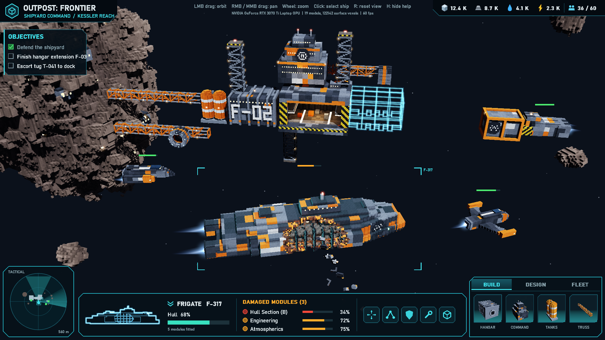

# Outpost:Frontier — voxel shipyard sample

A runnable Windows sample: a tactical view of an orbital shipyard drawn entirely from MagicaVoxel models with a Direct3D 12 ray-box voxel renderer, under a military command-and-control HUD.



What is on screen:
- an asteroid cropped along the left edge;
- the open, warm-lit hangar of a modular shipyard;
- a cyan blueprint of the next hangar section, sitting on the docking socket and built from the same module geometry;
- frigate F-317 with a breached hull section (exposed frames and decks, ember glow, drifting fragments) and twin blue engine plumes;
- two escorts of different classes;
- a tug carrying a prefab module in an orange frame;
- sparse stars and small rocks.

The HUD shows objectives, resources, a radar, the selected ship's panel with its damaged modules, and a build panel with live module thumbnails.

**The sample is the starting point of a game, not the game.** [Design/GameDesign.md](Design/GameDesign.md) says what the game is: the player flies one ship with a cursor, owns an outpost built module by module on an asteroid, and commands a small fleet from this tactical view. Every solid thing is voxels, and removing voxels is the damage model. The design's build order starts from this scene, and its first six slices make the three objectives on the HUD things a player can complete.

How the code is written is in [AGENTS.md](AGENTS.md); the engineering decisions behind it are in [Design/ADR/](Design/ADR/).

## Requirements

| | Version used to build and verify |
|---|---|
| Visual Studio | 2026 Community 18, workload *Desktop development with C++* |
| Toolset | MSVC `v145` (compiler 14.51), MSBuild 18, `/std:c++latest` |
| Windows SDK | 10.0.26100.0 — supplies D3D12, DXGI, DirectXMath, WIC and `dxc.exe` |
| GPU | Direct3D 12, feature level 12_1, shader model 6.7 — or WARP (`--warp`) |
| CPU | AVX2 (the projects compile `/arch:AVX2`) |

Nothing else today: no packages, no Agility SDK, no `d3dx12.h`. NuGet is the repository's package manager and libraries are approved one at a time (AGENTS.md R14); none is used yet.

That stays true for building, testing and single player. Networked play, the design's slice 10, will add one library: MsQuic, Microsoft's QUIC implementation, restored from the NuGet package `Microsoft.Native.Quic.MsQuic.Schannel`, the first library approved under AGENTS.md R14. It will also need Windows 11 or Windows Server 2022, whose TLS 1.3 the Schannel build uses. Nothing in the tree uses it yet.

## Build and run

Run these from the repository root in a *Developer PowerShell for VS 2026*. Always build through the solution — see AGENTS.md §3 for why.

```powershell
# Everything, Debug and Release
msbuild Outpost.Frontier.slnx /p:Configuration=Debug   /p:Platform=x64 /m /v:minimal /nologo
msbuild Outpost.Frontier.slnx /p:Configuration=Release /p:Platform=x64 /m /v:minimal /nologo

# One project: <SolutionFolder>\<Project> for a project in a folder, the bare name at the root
msbuild Outpost.Frontier.slnx "/t:Engine\NeuronClient" /p:Configuration=Debug /p:Platform=x64 /m /nologo
msbuild Outpost.Frontier.slnx /t:Outpost /p:Configuration=Debug /p:Platform=x64 /m /nologo

# Run: borderless fullscreen on the primary monitor
.\x64\Debug\Outpost.exe

# Run in a framed window instead (the size shrinks to fit the work area if it must)
.\x64\Debug\Outpost.exe --windowed --size 1600x900
```

Or open `Outpost.Frontier.slnx` in Visual Studio, set **Outpost** as the startup project and press F5.

Each build copies `Assets\` next to the executable, and the executable finds its assets from its own location, never the working directory. So F5, double-clicking `x64\Release\Outpost.exe`, or running a copied output folder all work. `--assets <dir>` points it at another Assets folder, for example `--assets Assets` to pick up scene edits without rebuilding.

## Controls

| Input | Action |
|---|---|
| Left drag | Orbit the camera |
| Left click (no drag) | Select the ship under the cursor; click empty space to clear the selection |
| Right or middle drag | Pan |
| Mouse wheel | Zoom |
| R or Home | Reset the camera to the scene's starting view |
| H | Show or hide the controls line |
| F3 | Show or hide the status line (adapter, model and voxel counts, fps) |
| F11 or Alt+Enter | Switch between borderless fullscreen and a framed window |
| F12 | Save a screenshot to `Captures\` next to the executable |
| Esc | Quit |

Ships behind the camera or off screen get an edge arrow that points toward them; a ship behind the camera is labelled *(behind)*.

## Where things live

| What | Where |
|---|---|
| The design: what the game is, system by system, and the order to build it in | [`Design/GameDesign.md`](Design/GameDesign.md) |
| The MVP implementation plan: the design's first six slices as tasks, tests, ADRs and exit criteria | [`Design/ImplementationPlan.md`](Design/ImplementationPlan.md) |
| The scene: camera, lights, models, sockets, instances, ships, module damage, engines, objectives, resources, build items | [`Assets/Scene.txt`](Assets/Scene.txt) — plain text, documented in its header and in ADR-002 |
| The models | `Assets/Models/*.vox` — genuine MagicaVoxel files, open them in MagicaVoxel |
| The canonical palette (role → colour) | [`GameCore/Palette.h`](GameCore/Palette.h) for the index map, [`GameCore/Palette.cpp`](GameCore/Palette.cpp) for colours and the emissive material table |
| The generator that wrote the models | [`AssetGenerator/`](AssetGenerator/) — one recipe per model |
| VOX → world conversion | [`NeuronCore/ModelAxes.h`](NeuronCore/ModelAxes.h), explained in ADR-002 |
| Renderer and shaders | [`NeuronClient/Renderer.cpp`](NeuronClient/Renderer.cpp), [`NeuronClient/Shaders/`](NeuronClient/Shaders/), explained in ADR-003 |

**VOX to world.** VOX is right-handed, +Z up, with ships facing +Y; the world is Direct3D left-handed with +Y up. A VOX point `v` in a model with pivot `p` and voxel size `s` lands at `((v.x−p.x), (v.z−p.z), (v.y−p.y))·s`, then goes through the instance's scale, yaw/pitch/roll and position. Socket, engine and light positions in `Scene.txt` are VOX coordinates of their model.

### Regenerating the models

```powershell
.\x64\Release\AssetGenerator.exe --out Assets     # rewrite all 19 .vox files (deterministic, ~0.4 s)
.\x64\Release\AssetGenerator.exe --check          # exit 1 if any committed file is stale
```

A **new** asset file must also be added to the `Outpost` project in Visual Studio (*Add › Existing Item*, Item Type *Copy file*, destination `$(OutDir)Assets\Models`), or the build will not copy it next to the executable.

Every file carries the identical canonical RGBA palette chunk. Index 0 is empty, and voxel colour `c` is chunk entry `c−1`. Glow comes from the renderer's material table, not from the file.

## Tests and checks

```powershell
# Unit tests: every suite the build produced (no GPU needed)
& "C:\Program Files\Microsoft Visual Studio\18\Community\Common7\IDE\Extensions\TestPlatform\vstest.console.exe" (Get-ChildItem x64\Debug -Filter *Tests.dll).FullName /Platform:x64

# Smoke test: fixed timeline on WARP, image checks, debug layer on; exit code 0 on success
.\x64\Debug\Outpost.exe --smoke-test --warp --capture smoke.png --report smoke.txt --compare "Design\Space Station HUD Without Navigation Path.png"

# The checkers CI runs (AGENTS.md §6). The pinned tools: pip install clang-format==18.1.3 clang-tidy==22.1.8
python Build\CheckProjectFiles.py    # build shape, registration, Debug/Release alignment, R2, R7, R11, R14
python Build\CheckFormat.py          # clang-format over every .h/.cpp; --fix rewrites
python Build\RunClangTidy.py         # after a build, in a Developer PowerShell; --dry-run prints the commands
python Build\TestCheckers.py         # the checkers' own tests
```

Every library has its own test project under `Tests\`. In Visual Studio, *Test › Test Explorer* runs them all.

| Project | Tests | Covers |
|---|---|---|
| `Tests\NeuronCoreTests` | 28 | VOX read/write and a hand-authored fixture that pins the palette offset; rejection of bad magic, truncated chunks, invalid dimensions and out-of-bounds voxels; meshing of single and adjacent voxels; wireframes and the side profile; VOX-to-world axes, handedness and socket mating; the wire format's byte order and round trips; the in-process transport's order and datagram budget |
| `Tests\NeuronClientTests` | 8 | Selection maths: ships ahead, beside the view, straddling the near plane and behind the camera; pick rays; click versus drag; orbit-camera limits |
| `Tests\NeuronServerTests` | 5 | The tick clock at 60 Hz (ADR-007): whole ticks, carried remainders, ten minutes exactly 36,000 ticks, stall catch-up, interpolation |
| `Tests\GameCoreTests` | 21 | The canonical palette, including byte equality across every generated file; scene parsing and validation; the shipped blueprint landing on its dock; the message catalogue: round trips, header, refusals, routes, the datagram budget |
| `Tests\GameLogicTests` | 5 | The world: the first snapshot, exact income per minute, fractional income, capacity, reloading |
| `Tests\GameAppTests` | 6 | The HUD: every vertex on screen at 720p, 1080p and 4K with ships off screen and behind the camera; build slots; scaling; fonts. The draw constants the voxel shader unprojects through |

Smoke-test options: `--frames N`, `--size WxH`, `--no-vsync`, `--debug-layer` / `--no-debug-layer`, and `--assets <dir>`. The smoke test always renders in a window of exactly `--size`, never fullscreen, so its captures do not depend on the monitor.

Exit codes:

| Code | Meaning |
|---|---|
| 0 | Success |
| 1 | Bad command line |
| 2 | No suitable device (FL 12_1 / SM 6.7) |
| 3 | Scene invalid |
| 4 | Render failure |
| 5 | Debug-layer errors |
| 6 | Image check failed (blank, flat, or missing the cyan HUD or warm lights) |
| 7 | Capture failed |

### What was run for this version

All of the following passed on 2026-11-21, on Windows 11 with an RTX 3070 Ti Laptop GPU:
- **Builds:** Debug and Release x64 through the solution, with `/warnaserror`: zero warnings.
- **Unit tests:** `vstest.console.exe` over all six `*Tests.dll` suites, Debug and Release: 55 of 55 passed.
- **Smoke test on WARP**, Debug (debug layer on) and Release, at 1920×1080:
  - exit 0; 0 debug-layer errors and 0 warnings;
  - mean luminance 0.146, lit 26.8%, cyan 1.92%, warm 2.63%, 658 colours;
  - composition similarity 0.794 to the reference image.
- **Smoke test on hardware:** Release, 120 frames at 1920×1080, and Debug with the debug layer, 60 frames at 1280×720. Both exited 0 with 0 debug-layer errors. The screenshot above is the Release capture.
- **Interactive Debug build, driven by a script:** two resizes, minimise to 0×0, restore, another resize, an orbit drag, an F12 capture, then close. It exited 0 with 0 debug-layer errors. The close path was repeated 10 times after the shutdown fix described in ADR-003, with no hangs.
- **`AssetGenerator --check`:** the Debug- and Release-built generators both reproduce the committed `.vox` files byte for byte.
- **Formatting:** clang-format **18.1.3**, the version CI pins, over every `.h`/`.cpp`: no changes needed.
- **clang-tidy:** the repository's `.clang-tidy` over all 42 translation units: 0 findings. This was the 22.1.3 shipped with Visual Studio; CI pins 22.1.8.

Not run here:
- the GitHub Actions workflow itself;
- `Build/CheckFormat.py`, `Build/CheckProjectFiles.py` and `Build/RunClangTidy.py`, which did not exist yet. They were added on 2026-11-22 and CI runs them; see *Tests and checks*.

## Scope

In scope: one static tactical scene; camera control; ship selection and inspection; HUD; asset generation; tests.

Out of scope, by the brief: a ship editor, live destruction, combat and networking. The client draws a server snapshot in-process, which is where a transport would go.

Where the design puts those ([Design/GameDesign.md](Design/GameDesign.md) §11): combat and live destruction arrive together in slice 3, as voxel damage; networking is slice 10, over QUIC with MsQuic (GameDesign.md §8.1), and the rules that keep it possible bind from slice 1 (AGENTS.md R18 to R25); a ship editor is not part of the game. The hull and module percentages and the resources the HUD shows are read from `Scene.txt` today; in the design they are measured from voxel masks and produced by the outpost.
